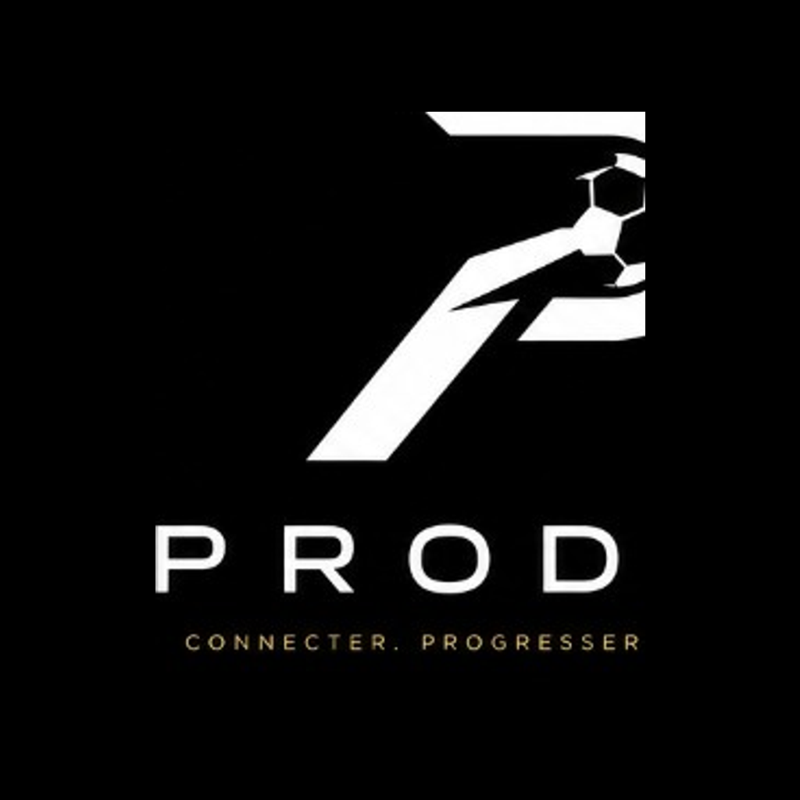
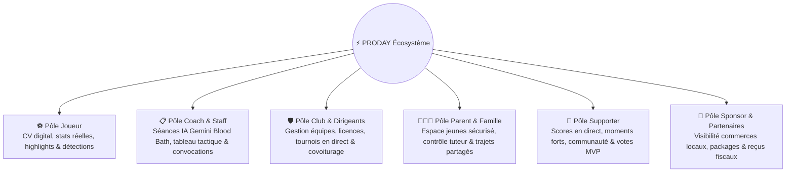

<div align="center">



<br /><br />

# **CONNECTER · PROGRESSER · RÉVÉLER**

<br />

*Pas un outil de plus. L’infrastructure de votre football.*  
App mobile **1.0.9** (Build iOS 19 / VersionCode Android 11) · Site [proday75.fr](https://proday75.fr)

<br />

[](https://proday75.fr)
[-0ea5e9?style=flat-square&logo=apple)](https://appstoreconnect.apple.com/apps/6801583755/testflight/ios)
[-34d399?style=flat-square&logo=android)](https://proday75.fr/downloads/proday-beta.apk)
[-22c55e?style=flat-square)](https://github.com/alfredgibeau-ahoussinou/PRODAY)

<br />

**© ProDay 2026 — Tous droits réservés** · Code propriétaire  
📖 Documentation publique : [PRODAY-docs](https://github.com/alfredgibeau-ahoussinou/PRODAY-docs)

</div>

---

## 🌟 ProDay en Bref

ProDay n’est pas une juxtaposition d'applications disparates. C’est **l’infrastructure unifiée du football amateur et professionnel** : joueurs, coachs, dirigeants de clubs, familles, supporters et sponsors réunis au sein d'une seule donnée partagée.

| Information | Détail |
| :--- | :--- |
| **Slogan** | CONNECTER · PROGRESSER · RÉVÉLER |
| **Positionnement** | L’infrastructure de votre football |
| **Site Officiel** | [https://proday75.fr](https://proday75.fr) |
| **Application Mobile** | **Version 1.0.9** (TestFlight iOS Build 19 · APK Android VersionCode 11) |
| **Moteur IA** | Google Gemini 1.5 Flash (100% quota gratuit · Séances sur-mesure & Mode Blood Bath) |
| **Identifiants App Store** | Bundle `com.proday.app` · ASC App ID `6801583755` · Team `F452SUU638` |
| **Logo & Charte** | `assets/branding/logo-proday-official.png` · Palette officielle `#07100c` / `#F5D04A` / `#C5A059` |

---

## 🧭 Les 6 Pôles Métier

Une porte d’entrée dédiée par rôle vers le même graphe de données :



---

## 🏗️ Architecture du Monorepo

```
PRODAY/
├── src/                  Application mobile Expo (React Native & TypeScript)
│   ├── features/admin/   Centre de commande exécutif VIP & outils rapides
│   ├── screens/          Écrans des 6 pôles métier et auth
│   ├── services/         Services Firestore, Gemini AI, Stripe & Storage
│   └── context/          Contextes React (Auth, Mode, Admin, Offline)
├── website/              Site web officiel (Next.js 16, React 19, Tailwind CSS 4)
│   ├── public/downloads/ APK téléchargeable (proday-beta.apk)
│   └── public/videos/    Vidéo Motion 60 FPS (proday-intro.mp4)
├── functions/            Cloud Functions Firebase (TypeScript & Gemini Flash)
├── firebase/             Règles de sécurité Firestore, Storage & Indexes
├── assets/               Identité de marque, logos transparents, vidéo intro & Stories Instagram
├── docs/                 Guides opérateur, conformité stores & architecture
└── scripts/              Outils CLI, build APK local, seed démo & génération vidéo
```

---

## 🛠️ Stack Technologique

| Couche | Technologies |
| :--- | :--- |
| **Mobile** | Expo SDK 54 · React Native 0.81.5 · React 19 · TypeScript 5.9 · Reanimated 3 |
| **Web Production** | Next.js 16 (App Router / Turbopack) · Tailwind CSS 4 · Framer Motion · Netlify |
| **Backend & Base** | Firebase Auth · Cloud Firestore · Cloud Storage · Cloud Functions (Node.js 20) |
| **Intelligence Artificielle** | Google Gemini 1.5 Flash (génération de séances complètes d'entraînement) |
| **Paiements & Mécénat** | Stripe API & Webhooks pour abonnements clubs et packs sponsoring |
| **Builds & CI/CD** | EAS CLI (iOS TestFlight & Android APK/AAB) · Gradle 8.14 (JDK 17) |

---

## ⚡ Démarrage Rapide

### 1. Cloner et installer les dépendances
```bash
git clone https://github.com/alfredgibeau-ahoussinou/PRODAY.git
cd PRODAY
npm install
```

### 2. Configuration d'environnement
```bash
cp .env.example .env
# Renseigner vos variables Firebase et Google Client ID
```

### 3. Lancer l'application mobile en local
```bash
npm start           # Lance le serveur Metro Expo
npm run start:ios   # Lance le simulateur iOS
npm run android     # Lance sur émulateur Android
```

### 4. Lancer le site web en local
```bash
npm run website:dev # Démarre Next.js sur http://localhost:3000
```

---

## 🧪 Tests & Qualité de Code

```bash
# Vérification TypeScript stricte
npm run typecheck

# Exécution des 264 suites de tests Jest (1 386 tests unitaires)
npm test

# Tests des Cloud Functions
cd functions && npm test
```

---

## 🚀 Déploiement & Builds Bêta

### 🍏 iOS (TestFlight)
```bash
# Build cloud sur EAS et soumission à App Store Connect
npm run eas:build:testflight
npm run eas:submit:testflight
```

### 🤖 Android (APK & AAB)
```bash
# Compiler l'APK localement et le copier dans website/public/downloads/
npm run android:apk:beta

# Ou compiler via EAS Cloud
npm run eas:build:android:apk
```

### 🌐 Site Web (Netlify Production)
```bash
cd website
npm run netlify:deploy
```

---

## 📄 Licence & Propriété

© 2026 **ProDay** — Tous droits réservés.  
Ce code est un logiciel propriétaire confidentiel. Toute reproduction ou distribution non autorisée est strictement interdite.
