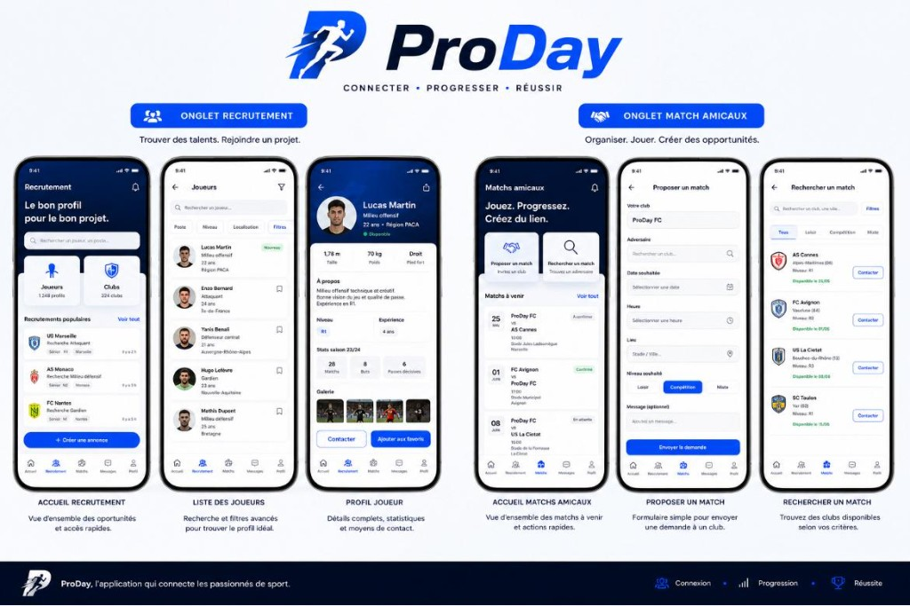
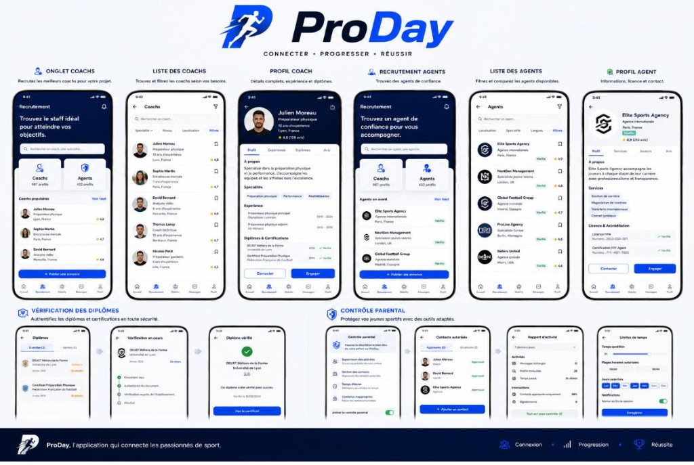
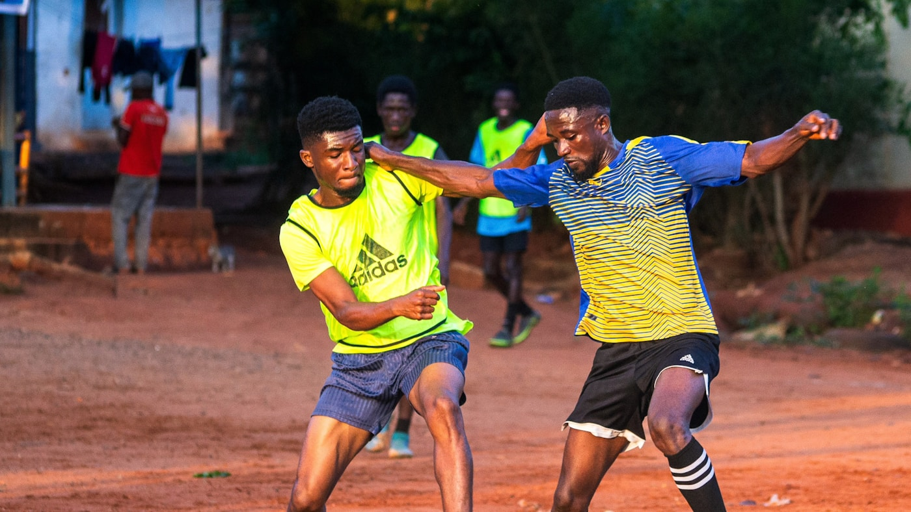
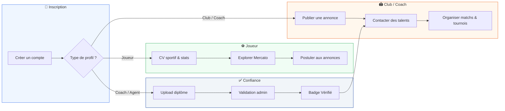
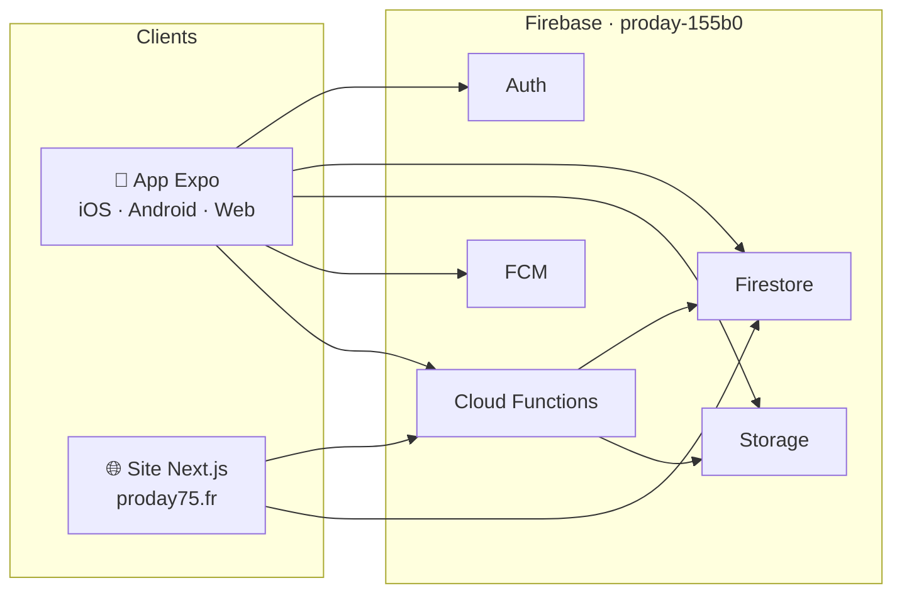

<div align="center">

<picture>
  <source media="(prefers-color-scheme: dark)" srcset="assets/branding/logo-dark.png">
  <source media="(prefers-color-scheme: light)" srcset="assets/branding/logo-light.png">
  
</picture>

<br /><br />

<h1>ProDay</h1>

<p>
  <strong>
    <span style="color:#003399">CONNECTER</span>
    &nbsp;•&nbsp;
    <span style="color:#2563EB">PROGRESSER</span>
    &nbsp;•&nbsp;
    <span style="color:#0F172A">RÉUSSIR</span>
  </strong>
</p>

<p><em>La plateforme mobile & web qui propulse le football amateur et semi-pro.</em><br />
Recrutement · Tournois · Matchs · Covoiturage · Santé · Sponsoring</p>

<br />

[](https://proday75.fr)
[](https://proday75.fr/beta/inscription)
[](https://proday75.fr/demo)
[](mailto:contact@proday.app)

<br /><br />

[](https://expo.dev)
[](https://reactnative.dev)
[](https://nextjs.org)
[](https://console.firebase.google.com/project/proday-155b0)
[](https://www.typescriptlang.org)
[](e2e/README.md)
[](app.json)
[](docs/BETA_LAUNCH.md)
[](https://github.com/alfredgibeau-ahoussinou/PRODAY)

</div>

---

## En un coup d'œil

<div align="center">

[](#quest-ce-que-proday-)
[](#-architecture--stack-technique)
[](website/README.md)
[](#-architecture--stack-technique)
[](docs/FIREBASE_SETUP.md)

</div>

---

## Qu'est-ce que ProDay ?

**ProDay** connecte joueurs, clubs, coachs, agents, organisateurs et partenaires autour d'une expérience sportive complète — du recrutement au match, de la santé au sponsoring.

<table>
<tr>
<td width="50%" valign="top">

### ⚽ Mercato
**Recrutement intelligent**

Profils joueurs, CV sportif, annonces clubs — mise en relation club ↔ talent en quelques taps.

</td>
<td width="50%" valign="top">

### 🏆 Arena
**Tournois & compétitions**

Organisation, brackets, scores live — tout pour animer vos compétitions.

</td>
</tr>
<tr>
<td width="50%" valign="top">

### 🤝 Matchs
**Amicaux & convocations**

Proposer, rejoindre, suivre — stats et résultats centralisés.

</td>
<td width="50%" valign="top">

### 🚗 Covoiturage
**Mobilité collective**

Points de rendez-vous et trajets match — arriver ensemble, gagner ensemble.

</td>
</tr>
<tr>
<td width="50%" valign="top">

### 💚 Santé
**Suivi activité**

Intégration Apple Santé & Health Connect pour suivre la forme.

</td>
<td width="50%" valign="top">

### 🏪 Sponsors
**Partenariats locaux**

Offres géolocalisées et conventions partenaires autour du club.

</td>
</tr>
</table>

> **Navigation mobile** — Accueil · Mercato · Matchs · Covoiturage · Santé · Feed · Messages · Profil (+ Shop)  
> **Modules secondaires** — Arena · Sponsors

---

## Aperçu produit

<table>
<tr>
<td align="center" width="33%">
<br />
<sub><b>Mercato</b> · Profils & annonces</sub>
</td>
<td align="center" width="33%">
<br />
<sub><b>Arena</b> · Brackets & scores</sub>
</td>
<td align="center" width="33%">
<br />
<sub><b>Matchs</b> · Amicaux & stats</sub>
</td>
</tr>
<tr>
<td align="center" width="50%" colspan="2">
<br />
<sub><b>Maquettes</b> · Recrutement + Matchs amicaux</sub>
</td>
<td align="center" width="50%">
<br />
<sub><b>Confiance</b> · Vérification diplômes</sub>
</td>
</tr>
</table>

<p align="center">
  <a href="assets/intro/proday-intro.mp4"></a><br />
  <sub>▶ <b>Vidéo d'intro</b> — <code>assets/intro/proday-intro.mp4</code> · générable via <code>npm run intro:build</code></sub>
</p>

---

## Parcours utilisateur



---

## Rejoindre la bêta

<div align="center">

> ### 🚀 ProDay est en bêta fermée
>
> Inscrivez-vous dès maintenant pour accéder en avant-première à la plateforme.

<br />

[](https://proday75.fr/beta/inscription)
[](https://proday75.fr/beta/installer)

</div>

| Lien | Usage |
|------|-------|
| [proday75.fr/beta/inscription](https://proday75.fr/beta/inscription) | Inscription waitlist (public) |
| [proday75.fr/beta](https://proday75.fr/beta) | Hub bêta (invitation email) |
| [proday75.fr/beta/programme](https://proday75.fr/beta/programme) | Programme — six pôles |
| [proday75.fr/beta/installer](https://proday75.fr/beta/installer) | Guides APK / TestFlight |
| [proday75.fr/beta/aide](https://proday75.fr/beta/aide) | FAQ et support |

```bash
npm run beta:check   # Firebase, typecheck, Jest, règles Firestore, pages légales
```

Guide complet : [docs/BETA_LAUNCH.md](docs/BETA_LAUNCH.md) · [docs/BETA_GUIDE.md](docs/BETA_GUIDE.md)

---

## Démarrage rapide

### Prérequis

- Node.js 20+
- [Expo CLI](https://docs.expo.dev/get-started/installation/) (via `npx expo`)
- Compte Firebase (projet `proday-155b0`)

### Installation

```bash
git clone https://github.com/alfredgibeau-ahoussinou/PRODAY.git
cd PRODAY
npm install
cp .env.example .env   # puis remplir les clés Firebase (console proday-155b0)
```

### Lancer l'app mobile

```bash
npm start            # menu Expo — QR code avec Expo Go
npm run web          # Expo Web (navigateur)
npm run ios          # simulateur iOS
npm run android      # émulateur Android
```

### Lancer le site vitrine

```bash
npm run website:dev  # → http://localhost:3000
```

Démo sans installer l'app : [localhost:3000/demo](http://localhost:3000/demo) — sélecteur Homme / Woman / Pro, 7 onglets comme sur mobile.

---

<details>
<summary><b>🏗 Architecture & stack technique</b></summary>
<br />



| Couche | Technologie |
|--------|-------------|
| **Mobile** | Expo SDK 54 · React Native 0.81 · TypeScript |
| **Site vitrine** | Next.js (`website/`) — 21+ routes, démo navigateur |
| **Backend** | Firebase Auth, Firestore, Storage, FCM |
| **Serveur** | Cloud Functions TypeScript (`functions/src/`) |
| **Sécurité** | `firebase/firestore.rules` — validation profils admin |
| **Builds store** | EAS Build · `com.proday.app` |

Données **réelles** depuis Firestore (pas de mock en production). Voir [docs/FIREBASE_SETUP.md](docs/FIREBASE_SETUP.md).

</details>

<details>
<summary><b>📁 Structure du projet</b></summary>
<br />

```
PRODAY/                          Monorepo ProDay
├── src/                         App mobile Expo → src/README.md
├── website/                     Site vitrine Next.js → website/README.md
├── functions/                   Cloud Functions → functions/README.md
├── firebase/                    Règles Firestore / Storage → firebase/README.md
├── docs/                        Documentation → docs/README.md
├── scripts/                     Outils CLI → scripts/README.md
├── assets/                      Branding, intro, diagrammes → assets/README.md
├── .maestro/                    E2E Maestro → .maestro/README.md
└── e2e/                         Guide tests → e2e/README.md
```

Carte détaillée : **[docs/STRUCTURE.md](docs/STRUCTURE.md)**

</details>

<details>
<summary><b>⚙️ Scripts essentiels</b></summary>
<br />

| Commande | Action |
|----------|--------|
| `npm run beta:check` | Checklist bêta (env, tests, règles, légal) |
| `npm run intro:build` | Génère la vidéo d'intro (`assets/intro/`) |
| `npm run firebase:deploy` | Déploie règles + index Firestore |
| `npm run firebase:deploy:functions` | Déploie Cloud Functions |
| `npm run eas:build:preview` | Build TestFlight / APK interne |
| `npm run eas:build:production` | Build production store |
| `npm run typecheck` | Vérification TypeScript |
| `npm test` | Tests Jest unitaires |
| `npm run test:e2e:maestro` | Flows E2E mobile (Maestro) |
| `npm run website:build` | Build production site Next.js |

</details>

<details>
<summary><b>📚 Documentation</b></summary>
<br />

| Document | Public | Sujet |
|----------|--------|-------|
| [docs/README.md](docs/README.md) | Tous | Index complet |
| [docs/STRUCTURE.md](docs/STRUCTURE.md) | Dev | Arborescence du monorepo |
| [docs/ARCHITECTURE.md](docs/ARCHITECTURE.md) | Dev | Diagrammes Mermaid |
| [docs/DATABASE_SCHEMA.md](docs/DATABASE_SCHEMA.md) | Dev | Schéma Firestore |
| [docs/API_CONTRACTS.md](docs/API_CONTRACTS.md) | Dev | Cloud Functions & services |
| [docs/FIREBASE_SETUP.md](docs/FIREBASE_SETUP.md) | Dev | Configuration Firebase |
| [docs/BETA_LAUNCH.md](docs/BETA_LAUNCH.md) | Ops | Lancement bêta |
| [docs/design/DESIGN_SYSTEM.md](docs/design/DESIGN_SYSTEM.md) | Design | Logo, couleurs, composants |
| [docs/design/ProDay_Brief.html](docs/design/ProDay_Brief.html) | Non-dev | Brief produit (export PDF) |

#### Pour les associés et non-développeurs

| Commande | Action |
|----------|--------|
| `npm run docs:open-mockups` | Maquettes HTML interactives |
| `npm run docs:open-brief` | Brief produit HTML |
| `npm run docs:guide-restant` | Guide associés PDF |
| `npm run docs:pactes` | Pactes associés (4 exemplaires) |

</details>

<details>
<summary><b>🛡 Validation des profils coachs & agents</b></summary>
<br />

Les coachs et agents **ne sont pas auto-validés** à la création :

```
Inscription → Upload diplôme/licence → PENDING → Admin → VERIFIED
```

- Badge orange : *Vérification en cours*
- Messagerie et contact joueurs : **bloqués** tant que `is_verified !== true`
- Implémentation : `src/services/profile.service.ts`

</details>

---

## Contact

<div align="center">

[](https://proday75.fr)
[](mailto:contact@proday.app)
[](https://github.com/alfredgibeau-ahoussinou/PRODAY)

<br /><br />

**ProDay © 2026** — Tous droits réservés · Code propriétaire

<br />

<sub>CONNECTER • PROGRESSER • RÉUSSIR</sub>

</div>
