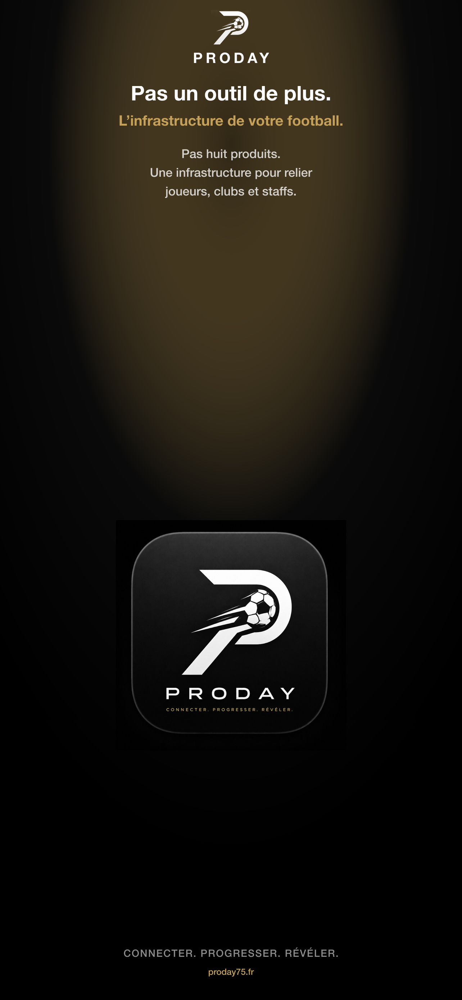
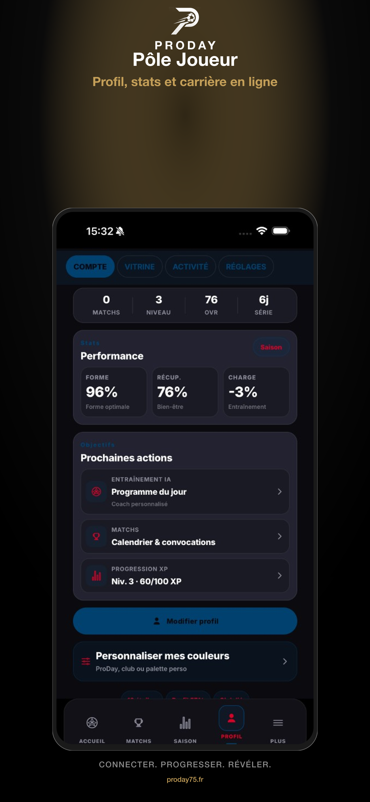
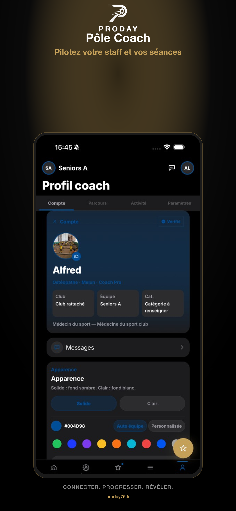
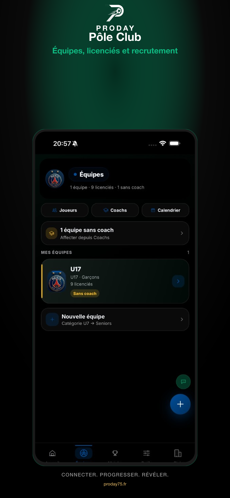
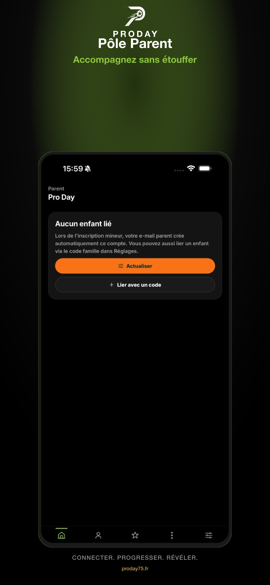
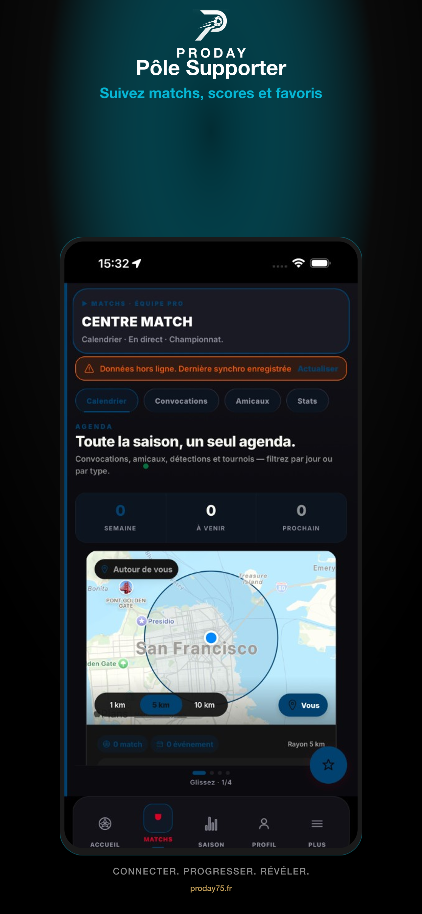
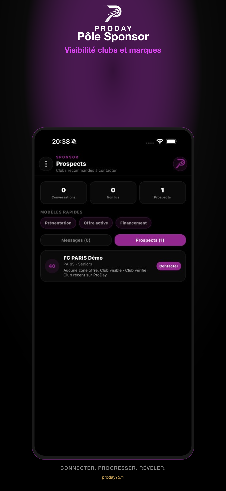
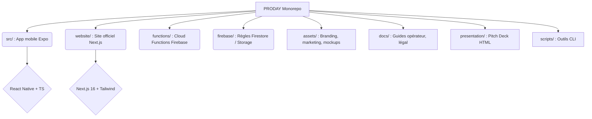

<div align="center">

<picture>
  <source media="(prefers-color-scheme: dark)" srcset="assets/branding/logo-proday-lockup-white.png">
  <source media="(prefers-color-scheme: light)" srcset="assets/branding/logo-proday-lockup-black.png">
  
</picture>

<br /><br />

# CONNECTER · PROGRESSER · RÉVÉLER

*Pas un outil de plus. L’infrastructure de votre football.*

[](https://proday75.fr)
[](https://proday75.fr/beta/inscription)
[](https://github.com/alfredgibeau-ahoussinou/PRODAY-docs)
[](package.json)

<br/>

<br/>

© ProDay 2026 · Tous droits réservés · Code propriétaire  
Documentation publique : [PRODAY-docs](https://github.com/alfredgibeau-ahoussinou/PRODAY-docs)

</div>

---

## 📖 Qu’est-ce que ProDay ?

ProDay n’est pas une collection d’apps séparées. C’est **l’infrastructure unifiée** du football amateur et professionnel : joueurs, coachs, clubs, familles, supporters et sponsors partagent le **même graphe de données**.

### 🌟 Six portes d’entrée, une seule plateforme

|  |  |  |
| :---: | :---: | :---: |
| **Joueur** | **Coach** | **Club** |
| CV digital, saison, Pulse, Mercato, highlights | Forme, tactique, convocations, séances | Équipes, licenciés, tournois, organisation |

|  |  |  |
| :---: | :---: | :---: |
| **Parent** | **Supporter** | **Sponsor** |
| Agenda, messages, trajets, contrôle tuteur | Scores, compositions, communauté | Activations locales, packages, impact |

*(Agent, recruteur, organisateur et santé restent des **rôles intégrés**, pas des produits séparés.)*

---

## 🏗 Structure du Monorepo



### 🛠 Stack Technologique

| Couche | Technologies clés |
|--------|------------------|
| **Mobile** | Expo SDK 54 · React Native 0.81 · React 19 · TypeScript |
| **Web** | Next.js 16 (App Router) · Tailwind CSS 4 · Framer Motion · Netlify |
| **Backend** | Firebase Auth · Firestore · Cloud Storage · Cloud Functions |
| **Paiements** | Stripe (abonnements clubs / sponsoring) |
| **Builds / CI** | EAS (TestFlight / APK) · Gradle |

---

## 🚀 Démarrage Rapide

### 1️⃣ Prérequis
Assurez-vous d'avoir installé **Node.js LTS** et **npm**. Vous devez également disposer d'un compte Firebase configuré (voir [`docs/FIREBASE_SETUP.md`](docs/FIREBASE_SETUP.md)).

### 2️⃣ Installation

```bash
git clone https://github.com/alfredgibeau-ahoussinou/PRODAY.git
cd PRODAY
npm install
# Configuration des variables d'environnement
cp .env.example .env   
```

### 3️⃣ Lancement de l'App Mobile

```bash
npm start              # Lancer Metro (Expo)
npm run start:ios      # Lancer sur simulateur iOS
npm run android        # Lancer sur émulateur Android
```

### 4️⃣ Lancement du Site Web

```bash
npm run website:dev    # Serveur de dev sur http://localhost:3000
```
*(Ou en naviguant dans `cd website && npm install && npm run dev`)*

### 5️⃣ Contrôle Qualité

```bash
npm run typecheck      # Vérification TypeScript
npm test               # Lancement des tests Jest
```

---

## 🚢 Déploiements (Aperçu)

| Cible | Commande | Documentation Associée |
|-------|----------|------------------------|
| **Site Netlify** | `cd website && npm run netlify:deploy` | [`website/README.md`](website/README.md) |
| **APK Bêta** | `npm run android:apk:beta` | [`docs/STORE_RELEASE.md`](docs/STORE_RELEASE.md) |
| **TestFlight** | (via EAS) | [`docs/BETA_IOS_LAUNCH.md`](docs/BETA_IOS_LAUNCH.md) |

💡 **Bêta Ouverte (Direct) :** [proday75.fr/beta/inscription](https://proday75.fr/beta/inscription)

---

## 📚 Documentation Additionnelle

Plongez plus profondément dans l'écosystème ProDay via nos guides dédiés :

- 📖 **Index interne principal :** [`docs/README.md`](docs/README.md)
- 🔒 **Sécurité et Architecture :** [`docs/WEBSITE_SECURITY.md`](docs/WEBSITE_SECURITY.md)
- 🎨 **Branding et Assets :** [`assets/branding/README.md`](assets/branding/README.md)
- 🌐 **Site Web détaillé :** [`website/README.md`](website/README.md)

---

## ⚖️ Licence & Propriété

© 2026 **ProDay** · Tous droits réservés.  
*Logiciel propriétaire. Reproduction, modification ou distribution non autorisée strictement interdite.*
