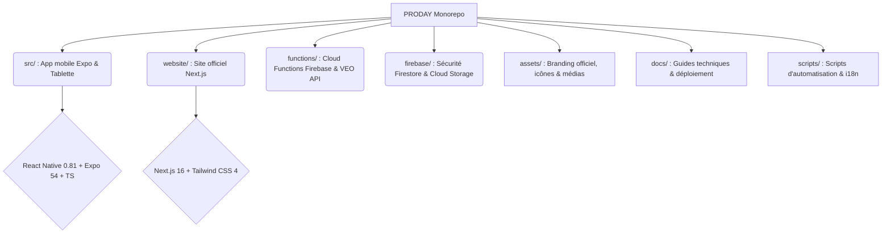

<div align="center">

<picture>
  <source media="(prefers-color-scheme: dark)" srcset="assets/branding/proday-logo-master-white.png">
  <source media="(prefers-color-scheme: light)" srcset="assets/branding/proday-logo-master-black.png">
  
</picture>

<br /><br />

# CONNECTER · PROGRESSER · RÉVÉLER

*L’infrastructure unifiée et intelligente de votre football.*

[](https://proday75.fr)
[](https://proday75.fr/beta/inscription)
[-blue?style=for-the-badge&logo=react)](package.json)
[-emerald?style=for-the-badge)](src/services/ollamaClient.ts)

<br/>

© ProDay 2026 · Tous droits réservés · Code propriétaire

</div>

---

## 📖 Qu’est-ce que ProDay ?

ProDay est la **plateforme applicative d'élite** dédiée à l'écosystème du football : coachs, clubs, staff technique et communauté partagent le **même graphe de données en temps réel**, sans intermédiaire superflu.

### 🌟 Pôles Actifs

|  |  |  |  |
| :---: | :---: | :---: | :---: |
| **Pôle Coach** | **Pôle Club** | **Pôle Community** | **Pôle Admin** |
| Pointage direct des présences terrain (1-tap), convocations, compositions tactiques, séances IA intégrées, centre match live et carnet d'entraînement. | Cockpit exécutif, import automatique FootClubs FFF (licences & suspensions), gestion des effectifs et intégration vidéo VEO native. | *Bientôt disponible* : Portail officiel partagé pour la communauté, les supporters et l'actualité des équipes. | Console de supervision, contrôle des accès, modération et suivi de l'infrastructure. |

---

## 🧠 Intelligence Artificielle 100% Dédiée

ProDay intègre une pile IA privative haute performance :
- **Moteur dédié :** Instance sécurisée Ollama ProDay Cloud (`europe-west1`), coût cloud LLM de 0 € par token.
- **Modèle :** `qwen2.5:3b` / `qwen2.5:7b` calibré pour le football (tactique, plans d'entraînement personnalisés, analyse de match).
- **Intégrations :** Copilote Coach, suggestions d'exercices adaptées et assistants tactiques d'avant-match et de mi-temps.

---

## 🏗 Structure du Monorepo



### 🛠 Stack Technologique

| Couche | Technologies clés |
|--------|------------------|
| **Mobile & Tablette** | Expo SDK 54 · React Native 0.81 · React 19 · TypeScript 5.8 |
| **Design System** | Thèmes Dynamiques Clair / Sombre · Tokens ProDay · Lucide & Ionicons · Haptics |
| **Web Vitrine** | Next.js 16 (App Router) · Tailwind CSS 4 · Framer Motion · Netlify |
| **Backend & Cloud** | Firebase Auth · Firestore · Cloud Storage · Cloud Functions (Node.js 20) |
| **Vidéo & Analyse** | Intégration VEO Camera API · Traitement et chapitrage tactique |
| **IA Privative** | Ollama Cloud Dédié (Reverse proxy Caddy TLS) · Stream SSE natif |
| **CI / CD & Builds** | EAS Build (iOS TestFlight & Android App Bundle) |

---

## 🚀 Démarrage Rapide

### 1️⃣ Prérequis
- **Node.js LTS** (v20+ ou v22+) et **npm**
- Projet Firebase configuré

### 2️⃣ Installation

```bash
git clone https://github.com/alfredgibeau-ahoussinou/PRODAY.git
cd PRODAY
npm install
cp .env.example .env
```

### 3️⃣ Lancement de l'App Mobile

```bash
npm start              # Démarre le serveur Metro Expo
npm run start:ios      # Lance l'application sur simulateur iOS
npm run android        # Lance l'application sur émulateur Android
```

### 4️⃣ Lancement du Site Web

```bash
npm run website:dev    # Serveur de développement Next.js (http://localhost:3000)
```

### 5️⃣ Contrôles Qualité & Validation

```bash
npm run typecheck                                # Vérification statique TypeScript stricte
npx jest src/__tests__/coachNavConfig.test.ts   # Tests navigation Coach
npx jest src/__tests__/clubNavConfig.test.ts    # Tests navigation Club
npm test                                         # Suite de tests globale
```

---

## 🚢 Déploiements

| Plateforme | Commande | Profil EAS |
|------------|----------|------------|
| **iOS TestFlight** | `eas build --platform ios --profile testflight` | Production / Store |
| **Android AAB / APK** | `eas build --platform android --profile preview` | Interne / Store |
| **Site Web** | `cd website && npm run netlify:deploy` | Production |

---

## ⚖️ Licence & Propriété

© 2026 **ProDay** · Tous droits réservés.  
*Logiciel propriétaire. Toute reproduction, distribution ou utilisation non autorisée est strictement interdite.*
