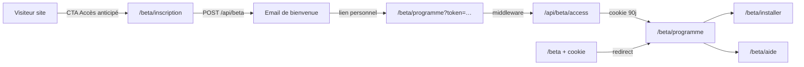

# Guide bêta ProDay — opérateur

Document de référence unique pour comprendre, exploiter et déployer le programme bêta fermé (site proday75.fr + app mobile).

> Voir aussi : `docs/BETA_WAITLIST.md` (dépannage EmailJS détaillé), `docs/BETA_LAUNCH.md` (checklist go/no-go mobile) et `docs/BETA_IOS_LAUNCH.md` (campagne iOS — 11 août 2026 à 18 h).

---

## Vue d'ensemble



---

## Tableau des URLs

| URL | Public ? | Qui y accède | Rôle |
|-----|----------|--------------|------|
| `/beta/inscription` | **Oui** | Tout visiteur | S'inscrire à la waitlist (formulaire + `POST /api/beta`) |
| `/beta` | **Non** | Beta-testeur (cookie) | **Redirect** → `/beta/programme` ; sans cookie → accès refusé |
| `/beta/programme` | **Non** | Beta-testeur (cookie) | **Point d'entrée email** — programme, 7 pôles, modules transverses |
| `/beta/installer` | **Non** | Beta-testeur (cookie) | Guides APK Android + TestFlight iOS |
| `/beta/aide` | **Non** | Beta-testeur (cookie) | FAQ bêta, contact support, retours |
| `POST /api/beta` | **Oui** | Formulaire inscription | Enregistre l'email + envoie le mail de bienvenue |
| `GET /api/beta/access` | **Non** | Lien email `?token=` | Valide le jeton, pose le cookie, redirige vers `/beta/programme` |

**Règle nav site :** tous les CTA « Accès anticipé » pointent vers `/beta/inscription` uniquement — jamais vers `/beta`.

---

## Parcours utilisateur (A → Z)

1. **Découverte** — Le visiteur clique sur « Accès anticipé » (nav, hero, tarifs, etc.) → `/beta/inscription`.
2. **Inscription** — Il choisit son profil (Joueur, Coach, Club…) et saisit son email.
3. **API** — `POST /api/beta` enregistre l'inscription et déclenche l'email de bienvenue (EmailJS ou Cloud Function Firebase).
4. **Email** — L'inscrit reçoit « Vous êtes beta-testeur ProDay » avec un bouton **Accéder à la bêta** → `{{beta_url}}` = `https://proday75.fr/beta/programme?token=…`.
5. **Validation** — Le middleware intercepte `?token=` sur `/beta` ou `/beta/programme` (et toute URL `/beta/*`) et redirige vers `/api/beta/access`.
6. **Session** — L'API valide le jeton, pose un cookie httpOnly `proday_beta_session` (90 jours, path `/beta`), redirige vers `/beta/programme`.
7. **Programme** — Le beta-testeur voit directement le programme (7 pôles) ; nav latérale vers Installer et Aide.
8. **App mobile** — Liens TestFlight / APK (env ou email ultérieur) ; retours via `/beta/aide` ou `proday.admin@gmail.com`.

### Visite ultérieure avec cookie

- `/beta` avec cookie valide → redirect automatique vers `/beta/programme`.
- `/beta` sans cookie → écran « Accéder à la bêta » (lien email requis).

### Sans jeton valide

- Accès direct à `/beta`, `/beta/programme`, etc. → écran « Accéder à la bêta » (lien email requis).
- Pas de contenu public sur ces pages.

---

## Parcours admin

### Site web — espace fondateurs (minicode)

URL : **https://proday75.fr/admin** (redirige vers `/admin/login` ou `/admin/beta`).

1. Les 4 fondateurs saisissent le **minicode** partagé (`BETA_ADMIN_PIN` sur Netlify).
2. Un cookie httpOnly `proday_admin_session` (7 jours) ouvre `/admin/beta`.
3. Depuis le tableau de bord : liste waitlist, compteurs, **Approuver** / **Refuser** / **Renvoyer email**.

Variables Netlify (serveur uniquement) :

| Variable | Rôle |
|----------|------|
| `BETA_ADMIN_PIN` | Minicode partagé (ex. 6 chiffres) — jamais dans le repo |
| `BETA_ADMIN_SESSION_SECRET` | Secret HMAC cookie (≥ 16 car.) |
| `BETA_WAITLIST_ADMIN_FUNCTION_URL` | URL CF `websiteBetaWaitlistAdmin` |
| `BETA_WEBSITE_ADMIN_SECRET` | Secret partagé site ↔ Firebase (même valeur côté Functions) |

Firebase Functions : définir `BETA_WEBSITE_ADMIN_SECRET` (ou `beta.website_admin_secret`) puis déployer `websiteBetaWaitlistAdmin`.

### Console app (Firebase Auth admin)

Dans l'app ProDay → panneau admin → segment **Bêta waitlist** :

- Liste les inscriptions Firestore (`beta_waitlist`) si la Cloud Function est déployée.
- Affiche email, profil, date d'inscription ; actions via callables `adminApproveBetaAccess`, etc.

### Firestore (optionnel)

Collection `beta_waitlist` — champs typiques :

| Champ | Description |
|-------|-------------|
| `email` | Adresse inscrite |
| `role` | ID profil (`player`, `coach`, …) |
| `status` | `pending` / `approved` / `rejected` |
| `access_token` | Jeton Firestore (si CF active) |
| `created_at` | Horodatage |

### Activer Pro manuellement (bêta)

Sans IAP actif, dans Firestore :

```
users/{uid}.subscription_tier = "pro"
users/{uid}.subscription_status = "active"
```

---

## Architecture code

```
website/src/app/beta/
├── inscription/page.tsx      # Public — waitlist
└── (site)/                   # Protégé par cookie
    ├── layout.tsx            # BetaProtectedLayout
    ├── page.tsx              # /beta → redirect programme si cookie
    ├── programme/page.tsx
    ├── installer/page.tsx
    └── aide/page.tsx

website/src/app/admin/
├── page.tsx                  # Redirect login ou /admin/beta
├── login/page.tsx            # Minicode fondateurs
└── beta/page.tsx             # Waitlist + approve / reject / resend

website/src/components/beta/
├── BetaHubContent.tsx
├── BetaProgrammeContent.tsx
├── BetaInstallerContent.tsx
├── BetaAideContent.tsx
├── BetaSiteShell.tsx         # Layout + session bar
├── BetaMiniSiteNav.tsx
└── BetaAccessDenied.tsx

website/src/lib/
├── betaAccess.ts             # Cookie, validation jeton
├── betaSignedToken.ts        # Jetons HMAC (fallback EmailJS)
├── betaEmailjs.ts            # Envoi EmailJS serveur
├── betaWelcomeEmail.ts       # Rôles + template fallback
├── betaContent.ts            # FAQ, timeline, liens APK/TestFlight
├── getBetaSession.ts         # Session RSC (cookie)
├── adminSession.ts           # Minicode + cookie admin
└── adminBetaApi.ts           # Proxy CF websiteBetaWaitlistAdmin

functions/src/
├── betaWaitlist.ts           # submitBetaWaitlist (Firestore + email)
├── betaAccess.ts             # validateBetaAccess
├── betaWaitlistAdmin.ts      # Callables app (Firebase Auth admin)
├── betaWaitlistWebsiteAdmin.ts # HTTP admin site (secret partagé)
└── betaWaitlistEmail.ts      # EmailJS côté Firebase
```

**Auth :** cookie httpOnly `proday_beta_session` — ne pas casser ce mécanisme. Le middleware ne touche pas `/beta/inscription`.

---

## Variables d'environnement

### Site (Netlify / `.env.local`)

| Variable | Obligatoire | Description |
|----------|-------------|-------------|
| `EMAILJS_SERVICE_ID` | Oui* | Service EmailJS |
| `EMAILJS_TEMPLATE_ID` | Oui* | Template bêta (`template_zkbezzh`) |
| `EMAILJS_PUBLIC_KEY` | Oui* | Clé publique EmailJS |
| `EMAILJS_PRIVATE_KEY` | Oui* | Clé privée (secret serveur) |
| `NEXT_PUBLIC_SITE_URL` | Oui | `https://proday75.fr` |
| `BETA_ACCESS_SECRET` | Recommandé | Secret HMAC ≥ 32 car. (jetons signés sans Firestore) |
| `BETA_WAITLIST_FUNCTION_URL` | Optionnel | CF `submitBetaWaitlist` |
| `BETA_VALIDATE_FUNCTION_URL` | Optionnel | CF `validateBetaAccess` |
| `BETA_ADMIN_PIN` | Admin site | Minicode fondateurs (`/admin`) |
| `BETA_ADMIN_SESSION_SECRET` | Admin site | Secret cookie session (≥ 16 car.) |
| `BETA_WAITLIST_ADMIN_FUNCTION_URL` | Admin site | CF `websiteBetaWaitlistAdmin` |
| `BETA_WEBSITE_ADMIN_SECRET` | Admin site + CF | Secret API partagé |
| `NEXT_PUBLIC_BETA_APK_URL` | Optionnel | Lien APK sur `/beta/installer` |
| `NEXT_PUBLIC_BETA_TESTFLIGHT_URL` | Optionnel | Lien TestFlight — affiché sur `/beta/installer` **après** le 11 août 2026 à 18 h |

\* Ou `BETA_WAITLIST_FUNCTION_URL` à la place des clés EmailJS.

### Firebase (optionnel — Blaze)

```bash
firebase functions:config:set \
  beta.emailjs_service_id="service_xxx" \
  beta.emailjs_template_id="template_xxx" \
  beta.emailjs_public_key="xxx" \
  beta.emailjs_private_key="xxx" \
  beta.site_url="https://proday75.fr"

firebase deploy --only functions:submitBetaWaitlist,functions:validateBetaAccess,firestore:rules
```

---

## Template email

- **Fichier source :** `docs/emailjs/beta-welcome.html`
- **Dashboard EmailJS :** template `template_zkbezzh`
- **Sujet :** `Vous êtes beta-testeur ProDay`
- **CTA :** `{{beta_url}}` → `/beta/programme?token=…` (programme directement)

Variables template :

| Variable | Valeur |
|----------|--------|
| `email` / `to_email` | Email inscrit |
| `member_role` | `Beta-testeur` |
| `profile_label` | Joueur, Coach, Club… |
| `site_url` | `https://proday75.fr` |
| `beta_url` | Lien personnel avec jeton |
| `subject` | Sujet de l'email |

---

## Déploiement

### Contrôle automatique

```bash
npm run beta:check
```

Vérifie Firebase, tests, pages légales, architecture bêta, endpoints prod.

### Site

```bash
cd website && npm run build          # build local
cd website && npm run netlify:deploy # production Netlify
```

### App mobile

```bash
eas build --profile preview --platform ios
npm run eas:build:preview -- --platform android
```

---

## Dépannage rapide

| Symptôme | Cause probable | Action |
|----------|----------------|--------|
| Pas d'email reçu | EmailJS mal configuré | Voir `docs/BETA_WAITLIST.md` § Dépannage |
| `503` sur `POST /api/beta` | Variables `EMAILJS_*` absentes | Ajouter sur Netlify → redeploy |
| `502` + `Invalid grant` | Gmail déconnecté dans EmailJS | Reconnecter le service Gmail |
| `/beta` sans contenu | Pas de jeton / cookie expiré | Rouvrir le lien email |
| Trop de redirections | Boucle `?token=` après `/api/beta/access` (Netlify) | Redéployer le site ; vérifier `location: …/beta` sans query |
| Jeton invalide | Secret HMAC changé ou CF non alignée | Vérifier `BETA_ACCESS_SECRET` / CF |

---

## Ce qui a été supprimé / fusionné

| Ancien | Statut |
|--------|--------|
| `BetaAccessContent` (page monolithique) | **Supprimé** — remplacé par le mini-site `/beta/*` |
| Formulaire sur `/beta` | **Supprimé** — formulaire uniquement sur `/beta/inscription` |
| CTA site vers `/beta` | **Corrigé** — tous les CTA → `/beta/inscription` |
| Docs éparpillées | **Consolidées** — ce guide + WAITLIST (EmailJS) + LAUNCH (mobile) |
