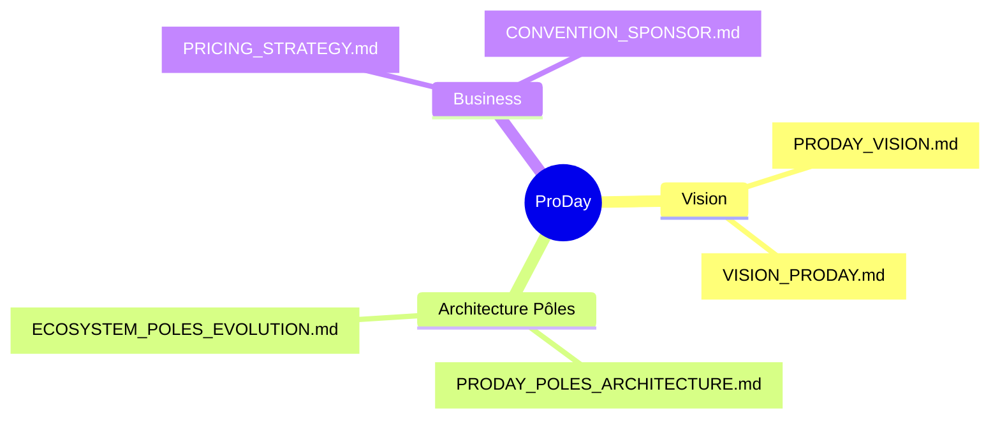

  

# 📚 Documentation Interne ProDay

**Index des guides internes (architecture, stores, Firebase, légal, site)**

*Bundle / ASC : `com.proday.app` · App ID `6801583755`*

---

## 🧭 Tableau de Bord de la Documentation

Bienvenue dans l'index de la documentation technique et organisationnelle de ProDay.  
*(Note : Les chiffres produit décrivent l’architecture, pas une audience live. Pas de métriques d’audience inventées dans ces docs.)*

### 🛠 1. Démarrage et Structure Code

| Guide | Description |
|-------|-------------|
| 🏠 [`../README.md`](../README.md) | Vitrine monorepo, stack technique globale et commandes de base |
| 📂 [`STRUCTURE.md`](./STRUCTURE.md) | Cartographie détaillée du code et des dossiers |
| 🔑 [`GITHUB_AUTH.md`](./GITHUB_AUTH.md) | Authentification Git et tokens GitHub |

### 🚀 2. Produit, Vision et Pôles

| Guide | Description |
|-------|-------------|
| 🎯 [`PRODAY_VISION.md`](./PRODAY_VISION.md) | Vision globale du produit ProDay |
| 🚪 [`PRODAY_POLES_ARCHITECTURE.md`](./PRODAY_POLES_ARCHITECTURE.md) | Détails des six portes métier (Joueur, Coach, Club, etc.) |
| 🔄 [`ECOSYSTEM_POLES_EVOLUTION.md`](./ECOSYSTEM_POLES_EVOLUTION.md) | Convergence et évolution des données |
| 💰 [`PRICING_STRATEGY.md`](./PRICING_STRATEGY.md) | Modèle économique et stratégie de tarification |
| 🤝 [`CONVENTION_SPONSOR.md`](./CONVENTION_SPONSOR.md) | Processus de partenariats et mécénat |

### ⚙️ 3. Architecture Technique et Base de Données

| Guide | Description |
|-------|-------------|
| 🏗 [`ARCHITECTURE.md`](./ARCHITECTURE.md) | Architecture logicielle globale de l'application |
| 🗄 [`DATABASE_SCHEMA.md`](./DATABASE_SCHEMA.md) | Schéma de données Firestore |
| 🔌 [`API_CONTRACTS.md`](./API_CONTRACTS.md) | Contrats d'API (Cloud Functions & Webhooks) |
| 🔥 [`FIREBASE_SETUP.md`](./FIREBASE_SETUP.md) | Configuration initiale de Firebase |
| 🤖 [`AI_SETUP.md`](./AI_SETUP.md) | Configuration de l'Intelligence Artificielle (Séances & Highlights) |
| ⚽ [`FFF_SYNC_3H.md`](./FFF_SYNC_3H.md) | Synchronisation des classements FFF toutes les 3 h : sources vérifiées, limites documentées, verrou, obsolescence |
| 🗂 [`proday-club-checklist.md`](./proday-club-checklist.md) | Checklist route par route du pôle Club/Admin : vérifié / à vérifier, défauts corrigés, blocages |
| 🗂 [`proday-coach-checklist.md`](./proday-coach-checklist.md) | Checklist route par route du pôle Coach : inventaire des destinations, mesures relevées, défauts corrigés et restants |
| 🛡 [`ADMIN_SETUP.md`](./ADMIN_SETUP.md) | Définition des rôles d'administration |
| 🔒 [`WEBSITE_SECURITY.md`](./WEBSITE_SECURITY.md) | Sécurité du site web (CSP, Admin PIN, Edge Functions) |
| 🌐 [`DOMAIN_PRODAY75_FR.md`](./DOMAIN_PRODAY75_FR.md) | Gestion du nom de domaine |

### 📲 4. Stores et Bêta

| Guide | Description |
|-------|-------------|
| 🍏 [`STORE_RELEASE.md`](./STORE_RELEASE.md) | Guide de publication sur l'App Store et Google Play |
| 📝 [`APP_REVIEW.md`](./APP_REVIEW.md) | Processus de validation ("Review") et préparation fiche store |
| 🧪 [`BETA_GUIDE.md`](./BETA_GUIDE.md) | Lancement de la Bêta Globale |
| 🍏 [`BETA_IOS_LAUNCH.md`](./BETA_IOS_LAUNCH.md) | Spécificités de la Bêta sur iOS (TestFlight) |
| ⏳ [`BETA_WAITLIST.md`](./BETA_WAITLIST.md) | Gestion de la liste d’attente |

### ⚖️ 5. Légal et Design

| Dossier | Description |
|---------|-------------|
| 📜 [`legal/`](./legal/) | CGU, Politique de confidentialité, pactes d'associés |
| 🎨 [`design/`](./design/) | Design system, briefs Figma, maquettes HTML |

### 🔧 6. Autres Configurations (Ops)

Des fichiers de variables spécifiques sont présents à la racine de ce dossier `docs/` pour la configuration de services tiers :
- **Stripe** (`STRIPE_*`)
- **EmailJS / Firebase Email** (`EMAIL*`)
- **Notifications Push FCM** (`PUSH_FCM_*`)
- **Appels Visio** (`*_VISIO_*`)

---

<i>Pour toute modification d'architecture, veuillez mettre à jour le document concerné pour refléter les changements sur le graphe de données.</i>

