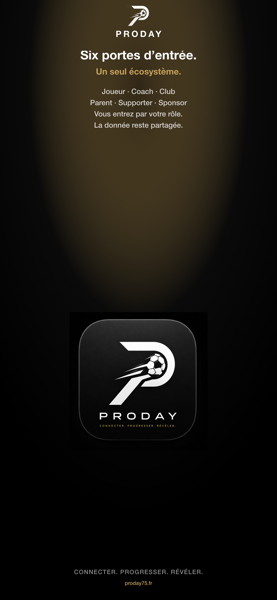
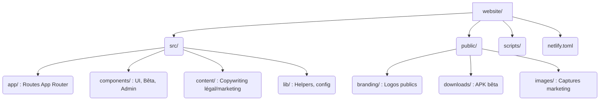

<div align="center">

<picture>
  <source media="(prefers-color-scheme: dark)" srcset="public/branding/logo-proday-lockup-white.png">
  <source media="(prefers-color-scheme: light)" srcset="public/branding/logo-proday-lockup-black.png">
  
</picture>

<br /><br />

# 🌐 Site ProDay · [proday75.fr](https://proday75.fr)

**CONNECTER · PROGRESSER · RÉVÉLER**  
*L’infrastructure de votre football · six portes d’entrée, une plateforme*

[](https://proday75.fr)
[](https://proday75.fr/beta/inscription)
[](https://proday75.fr/downloads/proday-beta.apk)

<br/>

<br/>

</div>

---

## 🎯 Rôle du Site Web

Le site web ProDay est le point d'entrée public de l'écosystème. Il gère :
- Le marketing et la présentation des fonctionnalités
- L'inscription au programme Bêta
- Les pages dédiées aux 6 portes métier (Joueur, Coach, Pro, Parent, Supporter, Sponsor)
- Les devis pour les clubs et sponsors
- Les documents légaux (CGU / Confidentialité)
- Le portail Admin (protégé par code PIN)
- Le téléchargement direct de l'APK (Android)

🛠 **Stack Technologique :** 
- **Framework :** Next.js 16 (App Router)
- **UI :** React 19 · Tailwind CSS 4 · Framer Motion
- **Hébergement :** Netlify

📌 *Version app documentée côté site : **1.0.9** (alignée sur `app.json` du monorepo).*

---

## 🏗 Architecture & Arborescence



---

## 🗺 Routes Principales

| Section | Routes Exemples | Description |
|---------|-----------------|-------------|
| 🏠 **Accueil** | `/` | Landing page principale |
| 🚪 **Portes** | `/joueur`, `/coach`, `/pro-club`, `/parent`, `/supporter`, `/sponsor` | Présentations ciblées par métier |
| 📦 **Produit** | `/fonctionnalites`, `/ecosysteme`, `/roadmap`, `/tarifs` | Détails de la plateforme et offres |
| 🧪 **Bêta** | `/beta/inscription`, `/beta/programme`, `/beta/installer` | Accès anticipé et guides d'installation |
| ⚖️ **Légal** | `/cgu`, `/confidentialite` | Conditions générales et RGPD |
| 🔒 **Admin** | `/admin` | Control Center ops (PIN HMAC) — produit total = app |

👉 *Pour plus de détails sur le code, voir [`src/README.md`](src/README.md).*

---

## 💻 Démarrage Local

### 1️⃣ Installation

Depuis le dossier `website` (ou via le monorepo) :
```bash
cd website
npm install
```

### 2️⃣ Variables d'Environnement

Créez un fichier `.env.local` *(ne jamais committer de secrets)* :
```env
NEXT_PUBLIC_SITE_URL=https://proday75.fr
NEXT_PUBLIC_BETA_APP_VERSION=1.0.9
NEXT_PUBLIC_BETA_APK_URL=/downloads/proday-beta.apk
# BETA_ADMIN_PIN, EmailJS, etc. (se référer à la doc docs/)
```

### 3️⃣ Lancement

```bash
npm run dev      # Démarre le serveur local sur http://localhost:3000
npm run build    # Compile le site pour la production
npm run lint     # Vérification du code
```
*Note : Depuis la racine du monorepo, vous pouvez utiliser `npm run website:dev` et `npm run website:build`.*

---

## 🚀 Déploiement Netlify

Le site est hébergé et déployé sur **Netlify**.

🌐 **Production :** [https://proday75.fr](https://proday75.fr)

```bash
npm run netlify:deploy
# Exécute le script : scripts/netlify-deploy.sh (isole .env.local)
```

🔒 **Sécurité :** Les politiques de sécurité (CSP, session admin HMAC, headers Edge) sont documentées dans [`../docs/WEBSITE_SECURITY.md`](../docs/WEBSITE_SECURITY.md).

---

## 🔗 Liens Utiles

- 🏠 **Monorepo racine :** [`../README.md`](../README.md)
- 🎨 **Branding source :** [`../assets/branding/`](../assets/branding/)
- 📖 **Docs publiques GitHub :** [PRODAY-docs](https://github.com/alfredgibeau-ahoussinou/PRODAY-docs)
